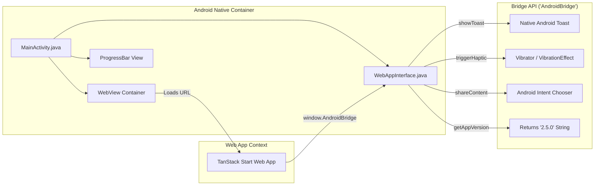

# Faczz Platform — Current Architecture Map
**Document Version:** 1.0.0 (Phase 0 Baseline)  
**Branch:** `faczz-production`  
**Base Commit:** `1c52584d296211204fcc0f3eafdf542181dc71ef`  
**Date:** November 2026  

---

## 1. Directory Structure & System Layout

```
faczz-2/
├── android/                            # Native Android Project Wrapper
│   ├── app/
│   │   ├── build.gradle                # Target SDK 34, Min SDK 21, versionCode 26
│   │   └── src/main/
│   │       ├── AndroidManifest.xml     # Package com.faczz.app, deep links, permissions
│   │       ├── java/com/faczz/app/
│   │       │   ├── MainActivity.java   # Android Activity hosting WebView & chrome client
│   │       │   └── WebAppInterface.java# JavascriptInterface bridge ("AndroidBridge")
│   │       └── res/                    # Launch icons, splash drawable, styles
│   └── build-apk.sh                    # Direct CLI toolchain compiler (aapt2 + javac + d8 + zipalign + apksigner)
├── docs/                               # Architecture, baseline, and planning specifications
├── public/                             # Static public assets
│   ├── _headers                        # Header overrides (MIME types for APK & caching)
│   ├── downloads/                      # Built APK binary (faczz-v2.6.0.apk)
│   ├── manifest.webmanifest            # PWA standalone manifest
│   ├── sw.js                           # PWA Service Worker (cache version faczz-pwa-v2.6.0)
│   └── *.svg / *.png                   # App icons, hero illustrations
├── src/                                # Main Application Source
│   ├── components/                     # Shared UI components & design system
│   │   ├── ai-paddock-scout.tsx        # F1 technical rumor & intelligence explorer
│   │   ├── app-shell.tsx               # Global responsive layout wrapper (Navbars, sidebars)
│   │   ├── bits.tsx                    # Badges, chips, metric cards, indicators
│   │   ├── data-comparison.tsx         # Multi-driver / multi-team comparison view
│   │   ├── data-menu.tsx               # Navigation menu across 16 data catalog views
│   │   ├── entity-profile.tsx          # Team / driver profile overview component
│   │   ├── feed-card.tsx               # News feed card with embedded media player
│   │   ├── race-card.tsx               # Grand Prix weekend countdown and schedule
│   │   ├── race-pace-explorer.tsx      # Interactive race pace & stint comparison chart
│   │   ├── social-post-card.tsx        # Social post with likes, reposts, comments, poll
│   │   ├── social-post-composer.tsx    # Interactive post authoring modal / composer
│   │   └── ui/                         # Base design system primitives (Radix UI + Tailwind)
│   ├── lib/                            # Business logic, stores, adapters, and mock data
│   │   ├── ai-scout.ts                 # Curated intelligence reports database
│   │   ├── data-catalog.ts             # 16 telemetry datasets with schema definitions
│   │   ├── data-views.ts               # Dataset mapping helpers
│   │   ├── demo-data.ts                # Teams, drivers, topics, sources, fallback standings
│   │   ├── error-capture.ts            # Client error listeners
│   │   ├── integrations.ts             # Data provider adapters (Jolpica/Ergast API fetchers)
│   │   ├── session-data.ts             # Deterministic session classifications
│   │   ├── store.ts                    # Single-state client store (useSyncExternalStore + localStorage)
│   │   └── utils.ts                    # Tailwind class merger (cn)
│   ├── routes/                         # TanStack Router File-Based Routes
│   │   ├── __root.tsx                  # Root layout, meta tags, SW registration, Toast
│   │   ├── index.tsx                   # Main Dashboard (Paddock Feed, Race Hero, Community)
│   │   ├── explore.tsx                 # Explore directory (Teams, drivers, news, intel scout)
│   │   ├── race.tsx                    # Dedicated Race Center & Live Timing view
│   │   ├── data.index.tsx              # Telemetry & Stats Catalog overview
│   │   ├── data.$slug.tsx              # Individual telemetry dataset view with controls
│   │   ├── driver.$id.tsx              # Driver profile & race history
│   │   ├── team.$id.tsx                # Constructor profile & telemetry breakdown
│   │   ├── source.$id.tsx              # Publisher source view
│   │   ├── story.$id.tsx               # Article / story reader view
│   │   ├── saved.tsx                   # User bookmarks & custom research collections
│   │   ├── notifications.tsx           # Alerts & notification feed
│   │   ├── profile.tsx                 # Profile & User Hub (Android App, Auth, Memory, Settings)
│   │   ├── welcome.tsx                 # First-time onboarding wizard
│   │   └── api/
│   │       ├── live-feed.ts            # GET: Server-side RSS aggregator (BBC + Autosport)
│   │       └── download-apk.ts         # GET: Static streaming download for APK
│   └── test/                           # Test suite (Vitest + JSDOM)
├── package.json                        # faczz v2.6.0 dependencies and build scripts
└── vite.config.ts                      # Vite 8 + TanStack Start + Nitro configuration
```

---

## 2. Website Architecture

### 2.1 Routing & SSR Pipeline
- **Router**: TanStack Router (`@tanstack/react-router` v1.170.41) using file-based tree generation (`src/routeTree.gen.ts`).
- **SSR Engine**: Nitro (`3.0.260603-beta`) embedded inside TanStack Start (`@tanstack/react-start` v1.168.60).
- **Client Hydration**: React 19 (`19.2.0`) with `suppressHydrationWarning` on `<html>` to accommodate client-side theme application from `localStorage`.
- **Styling Architecture**: Tailwind CSS v4 (`@tailwindcss/vite` v4.2.1) configured with OKLCH dynamic CSS variables in `src/styles.css`.

### 2.2 Client State Management (`src/lib/store.ts`)
- Powered by React 19's `useSyncExternalStore`.
- All persistent state is serialized into a single `localStorage` key: `"paddock-intel:v1"`.
- State schema holds:
  1. User account data (`user: UserAccount | null`).
  2. Preferences (`theme`, `homeEmphasis`, `raceMode`, `privacy`, `alerts`, `alertLead`).
  3. Following lists (`teams`, `drivers`, `topics`, `sources`).
  4. Bookmarks (`bookmarks: Bookmark[]`, `collections: Collection[]`).
  5. Notification history (`readNotifs`, `clearedNotifs`).
  6. Social state (`userPosts: SocialPost[]`, `comments: Record<string, SocialComment[]>`, `likes`, `reposts`, `commentLikes`, `pollVotes`).

---

## 3. Android Application Architecture



### 3.1 Components & Configuration
- **Package**: `com.faczz.app`
- **SDK Target**: Min SDK 21 (Android 5.0 Lollipop), Target SDK 34 (Android 14), Compile SDK 36.
- **Activity**: Single activity architecture (`MainActivity.java`).
- **WebView Configuration**:
  - `JavaScriptEnabled`: true
  - `DomStorageEnabled`: true
  - `DatabaseEnabled`: true
  - `AllowFileAccess`: true (security risk)
  - `UserAgent`: Appends `FaczzAndroidNative/2.6.0`
  - `JavascriptInterface`: Exposes `window.AndroidBridge`
- **Network Cleartext Traffic**: `android:usesCleartextTraffic="true"` enabled in `AndroidManifest.xml`.
- **Deep Linking Schemes**:
  - Custom URI scheme: `faczz://`
  - HTTPS App Link: `https://faczz.app`

---

## 4. Telemetry Adapters & Data Sources

All telemetry integrations reside in `src/lib/integrations.ts`, `src/lib/data-catalog.ts`, and `src/lib/demo-data.ts`:

| Adapter / Provider | Source Type | Endpoint / Implementation | Fallback |
| :--- | :--- | :--- | :--- |
| **Driver Championship** | Live REST API | `https://api.jolpica.com/ergast/f1/current/driverStandings.json` | `driverPoints` in `demo-data.ts` |
| **Constructor Championship**| Live REST API | `https://api.jolpica.com/ergast/f1/current/constructorStandings.json` | `teamPoints` in `demo-data.ts` |
| **Paddock Live Feed** | Live Server RSS | `/api/live-feed` -> BBC Sport & Autosport RSS | Static `feed` in `demo-data.ts` |
| **Track DNA / Circuits** | Static Dataset | `datasets["track-dna"]` in `data-catalog.ts` | Deterministic catalog data |
| **Speed Trap & Telemetry**| Static Dataset | `datasets["speed-trap"]` in `data-catalog.ts` | Deterministic catalog data |
| **Sector Performance** | Static Dataset | `datasets["sector-matrix"]` in `data-catalog.ts` | Deterministic catalog data |
| **Tyre Degradation** | Static Dataset | `datasets["tyre-degradation"]` in `data-catalog.ts` | Deterministic catalog data |
| **Race Pace Explorer** | Interactive Module | `src/components/race-pace-explorer.tsx` | Stint lap times model |
| **AI Paddock Scout** | Curated Intel DB | `PRESET_INTEL` in `src/lib/ai-scout.ts` | Filterable rumor & tech models |

---

## 5. Hardcoded IPs, URLs & Ephemeral Secrets

| Location | Hardcoded Value | Issue & Impact |
| :--- | :--- | :--- |
| `android/.../MainActivity.java:25` | `http://192.168.29.195:8080/` | Breaks mobile connectivity off the local router |
| `src/routes/profile.tsx:628` | `http://192.168.29.195:8080/` | Hardcoded Wi-Fi address displayed in the UI |
| `android/build-apk.sh:58-67` | `/tmp/faczz_android_build/release.keystore` | Generates a new keystore on every build, breaking app updates |
| `android/build-apk.sh:65-66` | `pass:faczz123` | Hardcoded keystore password in plaintext script |
| `android/.../WebAppInterface.java:50` | `return "2.5.0";` | Stale version string returned to JavaScript bridge |
