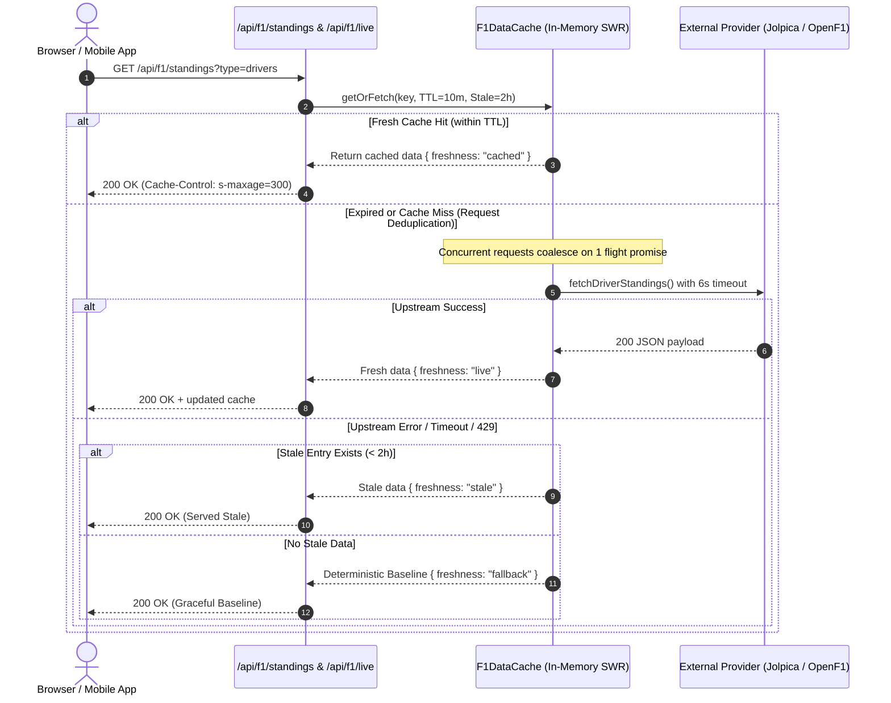

# Faczz F1 Data and Telemetry Architecture

## 1. Executive Summary

This document specifies the technical architecture, data providers, caching strategies, rate limit mitigations, and outage resilience mechanisms for the **Faczz Formula 1 Data & Telemetry Engine**.

The architecture decouples user-facing views from third-party APIs through a server-side caching and deduplication layer (`src/server/f1/`), guaranteeing continuous uptime, rapid response times (<50ms for cached hits), zero client-side credential exposure, and strict adherence to provider rate limits.

---

## 2. Telemetry Dataset Catalog (All 16 Views)

Faczz provides 16 structured motorsport telemetry and analytics views (`src/lib/data-catalog.ts`):

| # | Dataset Slug | Label | Category | Upstream Provider & Attribution | Refresh / Update Pattern |
| :- | :--- | :--- | :--- | :--- | :--- |
| **01** | `live-timing` | Live Timing | Live & Calendar | F1 Live Timing / OpenF1 API (`openf1.org`) | Real-time / 15s SWR polling |
| **02** | `schedule` | Schedule | Live & Calendar | Formula1.com Official Calendar (`formula1.com/racing/2026`) | Static Season Calendar |
| **03** | `results` | Results | Live & Calendar | Formula1.com Official Results | Per session completion |
| **04** | `driver-standings` | Driver Standings | Championship | FIA F1 World Championship / Jolpica Ergast API | 10m TTL / SWR |
| **05** | `constructor-standings`| Constructor Standings| Championship | FIA F1 World Championship / Jolpica Ergast API | 10m TTL / SWR |
| **06** | `drivers` | Drivers | Grid | FIA & Formula1.com Official Driver Database | Reference grid |
| **07** | `teams` | Teams | Grid | Formula1.com Official Constructor Directory | Reference grid |
| **08** | `driver-stats` | Driver Stats | Performance | StatsF1 / Formula1.com Official Records | Cumulative career stats |
| **09** | `head-to-head` | Head To Head | Performance | Formula1.com & FastF1 Official Qualifying H2H | Teammate delta comparison |
| **10** | `consistency` | Consistency | Performance | FastF1 Race Telemetry Transponder Loop Database | Standard deviation lap pacing |
| **11** | `race-pace` | Race Pace | Performance | FastF1 & Apex Analytics Telemetry Stint Model | Interactive stint lap explorer |
| **12** | `pit-stops` | Pit Stops | Technical | DHL Fastest Pit Stop Award Official Standings | Stationary pit stop durations |
| **13** | `tech-updates` | Tech Updates | Technical | FIA Formula 1 Event Technical Documents | Aerodynamic & chassis evolutions |
| **14** | `used-elements` | Used Elements | Technical | FIA Technical Delegate Power Unit Report | ICE, TC, MGU-K, MGU-H, ES, CE counts |
| **15** | `destructors-championship`| Destructors Championship| Concepts| FIA Stewards Incurred Damage Documents | Material crash and penalty tallies |
| **16** | `track-dna` | Track DNA | Concepts | Formula1.com Official Circuit Guides & Pirelli | Downforce, tyre deg & speed trap |

---

## 3. External Data Providers & Integrations

### 3.1 Jolpica Ergast API

- **Base URL**: `https://api.jolpica.com/ergast/f1`
- **Supported Endpoints**:
  - `GET /{season}/driverStandings.json`: Driver championship positions, points, wins, and constructor affiliation.
  - `GET /{season}/constructorStandings.json`: Constructor championship positions, points, and wins.
  - `GET /{season}.json`: Full season calendar and circuit details.
  - `GET /{season}/last/results.json`: Classification of the most recently completed Grand Prix.
- **Response Structure**:
  ```json
  {
    "MRData": {
      "StandingsTable": {
        "season": "2024",
        "StandingsLists": [
          {
            "DriverStandings": [
              {
                "position": "1",
                "points": "437",
                "wins": "9",
                "Driver": { "driverId": "max_verstappen", "code": "VER", "permanentNumber": "1", "familyName": "Verstappen" },
                "Constructors": [{ "constructorId": "red_bull", "name": "Red Bull" }]
              }
            ]
          }
        ]
      }
    }
  }
  ```
- **Rate Limits**:
  - Unauthenticated limit: **4 to 10 requests per second**.
  - Burst threshold: 429 Too Many Requests on sustained bursts.
- **Handling Provider Outages & Rate Limits**:
  - Server-side caching prevents client traffic from hitting Jolpica directly.
  - Stale-While-Revalidate (SWR): serves stale cached standings for up to 2 hours if Jolpica returns 500, 503, 429, or times out.
  - Fallback: deterministic points from `driverPoints` and `teamPoints` in `src/lib/demo-data.ts`.

### 3.2 OpenF1 API

- **Base URL**: `https://api.openf1.org/v1`
- **Supported Endpoints**:
  - `GET /sessions?meeting_key=latest`: Details for the current or latest race weekend session.
  - `GET /intervals?session_key=latest`: Real-time driver gaps, intervals to leader, and car numbers.
  - `GET /weather?session_key=latest`: Track temperature, air temperature, humidity, rainfall, and wind speed.
  - `GET /laps?session_key=latest`: Lap duration, sector 1/2/3 times, and in/out pit status.
- **Response Structure**:
  ```json
  [
    {
      "driver_number": 4,
      "gap_to_leader": 2.451,
      "interval": 0.812,
      "date": "2026-11-06T14:45:12.100Z"
    }
  ]
  ```
- **Rate Limits**:
  - Public limit: **3 requests per second**.
- **Handling Missing Sessions & Off-Season State**:
  - When no session is live (between race weekends or off-season), `intervals` returns an empty array `[]`.
  - The OpenF1 adapter detects empty arrays and falls back to session classifications generated by `sessionRows` (`src/lib/session-data.ts`).
  - Marked with `meta.freshness: "fallback"`.

---

## 4. Backend Caching & Request Coalescing Architecture



### 4.1 Request Deduplication (Flight Promise Coalescing)

When 100 clients request `/api/f1/standings` at the same second:
1. The first incoming request initiates an upstream HTTP fetch and stores the pending `Promise` in `F1DataCache.inflight`.
2. The remaining 99 requests detect the active promise and await it directly.
3. Only **1 single upstream HTTP request** is made to Jolpica.
4. Once resolved, the cache entry is populated, and all 100 clients receive the response simultaneously.

### 4.2 TTL and Stale Windows

| Resource | Cache Key | TTL (Fresh) | Max Stale Tolerance | Upstream Provider |
| :--- | :--- | :--- | :--- | :--- |
| **Driver Standings** | `driver-standings:{season}` | 10 minutes | 2 hours | Jolpica Ergast |
| **Constructor Standings** | `constructor-standings:{season}` | 10 minutes | 2 hours | Jolpica Ergast |
| **Live Timing Intervals** | `live-timing:latest` | 15 seconds | 2 minutes | OpenF1 API |
| **Track Weather** | `weather:latest` | 30 seconds | 5 minutes | OpenF1 API |

---

## 5. Data Validation & ID Normalization

External APIs often use divergent ID conventions:
- Jolpica Ergast uses `max_verstappen`, `red_bull`, `aston_martin`, `kick_sauber`.
- OpenF1 uses car numbers (`1`, `4`, `16`, `81`).
- Faczz uses canonical catalog keys (`verstappen`, `redbull`, `aston`, `audi`).

The normalization layer (`src/server/f1/mappings.ts`) executes deterministic matching:
1. Exact lookup in `ERGAST_DRIVER_MAP` and `ERGAST_CONSTRUCTOR_MAP`.
2. Fallback lookup by driver permanent FIA racing code (e.g. `VER`, `NOR`, `LEC`).
3. Fallback lookup by driver family name substring.
4. Permanent number resolution via `d.number === item.driver_number`.

All incoming payloads are strictly validated using Zod (`JolpicaDriverStandingRawSchema`, `OpenF1WeatherSchema`, `LiveSessionDataSchema`). Malformed fields are dropped or default-coerced rather than crashing the route handler.

---

## 6. Frontend Telemetry UI & Real-Time Polling

### 6.1 Championship Standings Widget (`src/components/championship-standings.tsx`)

- Embedded on the Paddock Homepage (`src/routes/index.tsx`) in the side column.
- Toggle between Drivers and Constructors standings.
- Displays Data Freshness Pill:
  - Green pulse: `LIVE · Jolpica Ergast API`
  - Amber dot: `CACHED (SWR) · In-Memory Server Cache`
  - Blue dot: `OFFICIAL ARCHIVE · Formula1.com`
- Manual "Refresh" button triggering `forceRefresh` on the server.

### 6.2 Race Center Controlled Polling (`src/routes/race.tsx`)

- Real-time updates occur via controlled 20-second background polling.
- **Page Visibility Guard**: When the user switches tabs or minimizes the window (`document.visibilityState === "hidden"`), polling is paused immediately, avoiding wasteful requests and battery drain.
- **Interactive Driver Delta**: Clicking any driver row in the timing tower selects them as the relative benchmark, recomputing all splits (e.g. `+0.412s` or `-0.185s`) in real time.

### 6.3 Telemetry Data Detail Charts (`src/routes/data.$slug.tsx`)

- **High-Contrast Bar Charts**: Bars colored dynamically using team colors (`<Cell fill={teamColor} />`).
- **Telemetry Tooltip**: Shows precise values, team name, and circuit metadata.
- **Freshness Banner**: Attributed provider indicator and server-side cache status for live-integrated views.

---

## 7. Security & API Protection

1. **Zero Secret Leakage**: No upstream API keys, bearer tokens, or internal IP addresses are exposed to the browser.
2. **HTTP Security Headers**: API routes emit appropriate `Cache-Control` (`public, s-maxage=300, stale-while-revalidate=1800`), `X-Data-Freshness`, and `Content-Type: application/json`.
3. **CORS Isolation**: Upstream APIs are proxied through server routes (`/api/f1/*`), eliminating browser cross-origin failures.
4. **Denial of Service Mitigation**: Upstream request coalescing guarantees external services are never flooded, even during peak traffic.
